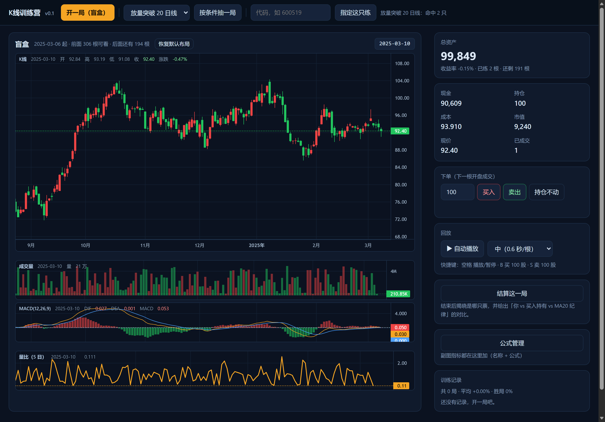
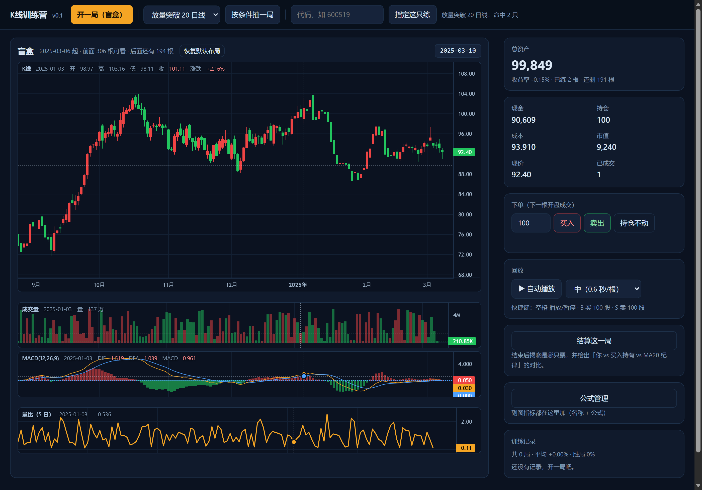
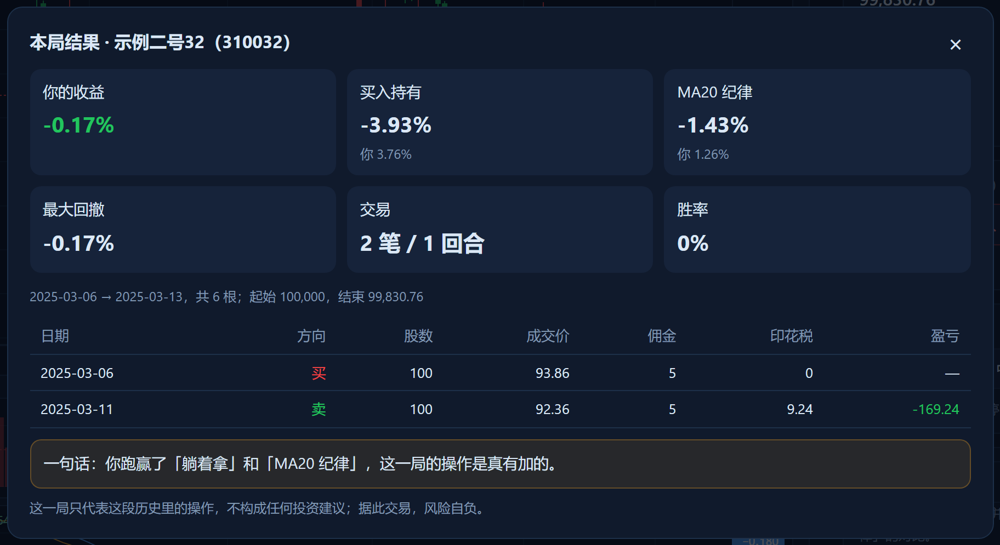

# K线训练营

[](LICENSE)


用你自己的本地日线练盘感的**逐根回放**训练器：不告诉你这是哪只票、什么时间，一根一根往前走，
你只能像真实交易那样「今天决定、明天开盘成交」。

> 数据来自本机 parquet，不联网、不调模型。这是一个**纯训练**工具：
> 只有回放、下单、记分，没有知识库、没有 AI 对话、没有实盘账本。

## 它跟别的 K 线训练工具有什么不一样

现成的方案（[KLinePlayground](https://github.com/FAT7/KLinePlayground)、TradingView 的 Bar Replay、
各种商业「K线训练营」App）都做了「隐藏未来 + 逐根推进 + 模拟成交」。
这个项目多一件事：**每局结束给三方对照**

| 你 | 买入持有 | MA20 纪律 |
|---|---|---|
| 你自己下的单 | 开局就买、拿到底 | 收盘站上 MA20 就满仓，跌破就空仓 |

三行数字摆在一起，这一局到底是「真有 alpha」还是「不如不做」，一眼就能看出来。
只看自己赚了 8% 没有意义——如果躺着拿能赚 15%，你那 8% 是负贡献。



十字光标停在主图上，竖线会贯穿所有副图，每块左上角显示那一天的数值：





> 上图用的是 `scripts/make_demo_data.py` 生成的**虚构行情**（代码 3100xx、名称"示例三号"这种），
> 不含任何真实股票数据。

## 功能

- **三种出题方式**
  - **盲盒**：随机一只 + 随机起点，不告诉你代码和名称（结算时揭晓）
  - **条件选股**：先按技术条件筛出一池，**再从命中里随机抽一只**——练的都是「今天有信号」的票
  - **指定**：自己填代码，练你正在盯的那只
- **逐根回放**：`买入` / `卖出` / `持仓不动` **点一下就走一根**（买入卖出在下一根开盘成交，
  成交价会显示在提示里）；也可以自动播放（0.25 / 0.6 / 1.2 秒一根）
- **副图**：跟同花顺一样**等高**，左上角是「名称 + 当天的值」；固定带**成交量**和 **MACD(12,26,9)**，
  再往下最多再挂 **3 个公式副图**。
  十字光标停在主图上时，**竖线会延续到每一块副图**，副图左上角同步显示那天的值。
  公式在右侧「公式管理」里加（名称 + 公式），存进 `formulas.json`，下次打开还在；
  `formulas.json` 已在 `.gitignore`，你自己的指标不会进仓库。[语法与示例](docs/FORMULA.md)
- **布局可调且会记住**：主图高度、副图高度、图表区宽度都能拖；拖完自动存 `layout.json`，
  下次打开还是这个布局（「恢复默认布局」一键还原）
- **真实成交规则**：下一根开盘价成交、T+1（当天买次日才能卖）、佣金万 2.5（最低 5 元）、卖出印花税千 1
- **实时账本**：总资产、现金、持仓、成本、市值、收益率
- **结算复盘**：收益率、最大回撤、胜率、逐笔明细，以及上面的三方对照
- **训练记录**：每局落 SQLite，看自己练了多少局、平均收益、胜局比例
- **快捷键**：`空格` 播放/暂停 · `B` 买 100 股 · `S` 卖 100 股

### 内置条件

| 条件 | 定义 |
|---|---|
| 放量突破 20 日线 | 收盘上穿 MA20，且成交额 ≥ 前 5 日均额 ×1.3 |
| 缩量回踩 20 日线 | 最低摸到 MA20 附近但收在线上，量缩到 5 日均量 0.8 倍以下 |
| 近 5 日有涨停 | 5 个交易日内至少一根涨幅 ≥ 9.5% |
| 强势低波 | 20 日涨幅 >15%，且 ATR 占价格 <5% |

## 快速开始

**Windows 双击「启动.bat」**：第一次会自动建 `.venv`、装依赖，然后打开
<http://127.0.0.1:8760>。以后双击就直接启动。

命令行方式：

```bash
python -m pip install -r requirements.txt   # 第一次
python run.py                               # → http://127.0.0.1:8760
```

也可以装成包（多一个 `kline-camp` 命令）：

```bash
python -m pip install -e .
kline-camp
```

> 注意是 `python -m pip install`，不是 `pip uvicorn`。缺依赖时 `run.py` 会直接告诉你该敲哪条。

## 数据

行情数据需要**自行获取**，或者用脚本**随机生成**一份——本项目不连任何行情接口。
把数据放到一个目录里，用 `KLINE_DATA_DIR` 指过去就行：

```bash
set KLINE_DATA_DIR=.\my-data       # 里面有 meta.parquet 和 bars/
```

目录里只要两样东西（字段说明见 [docs/DATA.md](docs/DATA.md)）：

```
<DATA_DIR>/meta.parquet            代码 / 名称 / 行业
<DATA_DIR>/bars/<代码>.parquet      日线：date open high low close volume amount
```

想先看看长什么样，可以生成一份**纯虚构**的随机行情（固定随机种子，和真实证券无关）：

```bash
python scripts/make_demo_data.py --out .\demo-data --stocks 40 --days 400
set KLINE_DATA_DIR=.\demo-data
python run.py
```

> 数据文件默认不进 git（体积大，而且如果你用的是付费数据源，二次分发可能违反数据方的授权），
> 仓库里只有读数据的代码和格式说明。

## 配置（环境变量）

| 变量 | 默认 | 说明 |
|---|---|---|
| `KLINE_DATA_DIR` | `./data` | 行情目录（里面有 `meta.parquet` 和 `bars/`） |
| `KLINE_DB` | `data/camp.sqlite3` | 训练记录 |
| `KLINE_CASH` | `100000` | 每局起始资金 |
| `KLINE_COMMISSION` / `KLINE_MIN_COMMISSION` / `KLINE_STAMP_TAX` | 0.00025 / 5 / 0.001 | 交易成本 |
| `KLINE_WARMUP` / `KLINE_MIN_FUTURE` | 120 / 60 | 开局前可看的根数 / 后面至少留多少根 |
| `KLINE_FORMULAS` | `./formulas.json` | 副图公式清单（含私有指标，不进 git） |
| `KLINE_LAYOUT` | `./layout.json` | 界面布局（拖出来的尺寸） |
| `KLINE_HOST` / `KLINE_PORT` | 127.0.0.1 / 8760 | 监听地址 |

## 目录

```
klinecamp/
  config.py      路径 / 交易成本 / 数据目录
  cli.py         启动（端口占用时认得出"已在运行"）
  data.py        读 parquet、随机出题
  window.py      全市场窗口扫描（条件选股用）
  screener.py    内置条件选股
  session.py     规则引擎：逐根推进 / 成交 / T+1 / 结算 / 基准
  formula.py     副图公式引擎（一行表达式的解析和计算）
  formulas.py    公式清单的读写（formulas.json）
  indicators.py  MACD
  layout.py      布局偏好（layout.json）
  store.py       训练记录（SQLite）
  api.py         HTTP 接口
  web/           前端（Lightweight Charts 已内置，不依赖 CDN）
tests/           规则测试（成交价 / T+1 / 费用 / 结算 / 公式 / 布局）
scripts/         开发工具（造演示数据、冒烟、生成截图）
docs/            数据格式、公式语法、README 截图
```

## 接口

| 方法 | 路径 | 说明 |
|---|---|---|
| GET | `/api/meta` | 数据概况与配置 |
| GET | `/api/conditions` | 可用的选股条件 |
| GET | `/api/conditions/{id}/count` | 某个条件今天命中多少只 |
| POST | `/api/session` | 开一局：`{mode:"blind"}` / `{mode:"screen",condition:"breakout20"}` / `{mode:"custom",code:"600519"}` |
| GET | `/api/session/{id}` | 当前状态 + 已可见的 K 线 |
| POST | `/api/session/{id}/step` | 前进一根 |
| POST | `/api/session/{id}/order` | `{side:"buy",shares:100}`，下一根开盘成交（默认顺带走一根） |
| POST | `/api/session/{id}/hold` | 持仓不动：撤掉未成交单并走一根 |
| POST | `/api/session/{id}/cancel` | 只撤单，不前进 |
| GET | `/api/session/{id}/macd` | MACD 副图数据 |
| GET | `/api/session/{id}/indicator?formula=…` | 按公式算一条副图（也可 `?id=` 选清单里的） |
| POST | `/api/session/{id}/finish` | 结算并入档 |
| GET | `/api/history` | 最近几局 + 汇总 |
| GET/POST | `/api/formulas` | 副图公式清单 / 存一条 |
| DELETE | `/api/formulas/{name}` | 删一条自定义公式 |
| GET/POST | `/api/layout` | 界面布局（读 / 存） |

## 测试

```bash
python -m pip install -r requirements-dev.txt   # 测试要 pytest
python -m pytest tests -q
```

规则相关的用例不需要行情数据；需要数据的那条会在没有数据时自动跳过。
CI（GitHub Actions）在 Ubuntu / Windows × Python 3.10 / 3.12 上跑这同一套。

## 接下来可以加的

- 分钟级回放（现在只做日线）
- 训练模式扩展：只给形态不给指标 / 限时决策 / 连对奖励
- 把「买卖点信号」也做成第四个对照（需要引入指标计算）
- 导出每一局的 K 线截图 + 你的操作，便于复盘

## License

MIT（见 [LICENSE](LICENSE)）。

**特别感谢**：

- K 线图用的是 TradingView 的 [Lightweight Charts](https://github.com/tradingview/lightweight-charts)（Apache-2.0，
  协议全文随仓库放在 `klinecamp/web/vendor/`）——没有它，这个项目要自己画 K 线，大概会难十倍。
- 产品形态参考了 [KLinePlayground](https://github.com/FAT7/KLinePlayground)（fat7，MIT）：
  「盲盒 / 指定」的出题方式、T+1 与手续费的口径、结束后的成绩单，都是从它那里学到的。
  想找功能更全的现成软件，直接用它。
- 界面布局跟同花顺学的：主图 + 等高副图、左上角的指标名称和数值、十字光标贯穿所有副图。

完整的第三方清单见 [THIRD_PARTY_NOTICES.md](THIRD_PARTY_NOTICES.md)。

## 免责声明

> **本项目仅供个人研究与学习，不构成任何投资建议。**
> 行情数据来自第三方接口（或你自备的本地数据），可能存在缺失、错误或延迟；
> 副图公式与结算数字都是按代码算出来的，不含"预测"。
> **据此交易，风险自负。** 作者不对任何直接或间接的投资损失承担责任。
> 训练成绩只反映"在这段历史里你按这套规则做了什么"，不代表未来收益。
